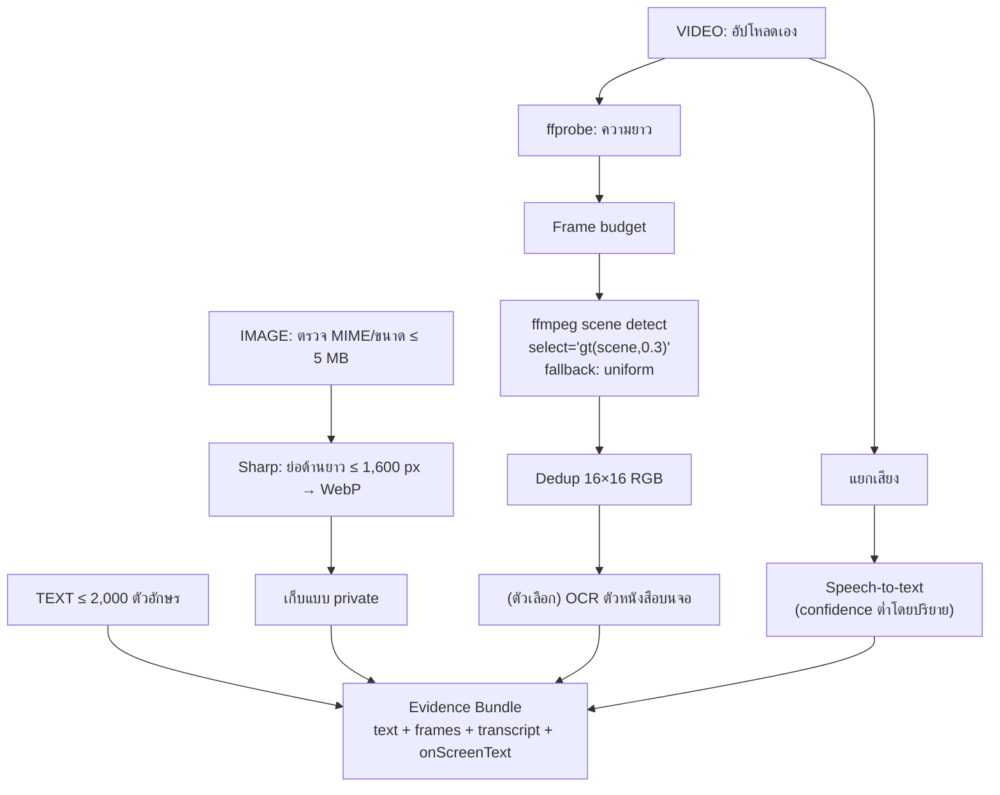
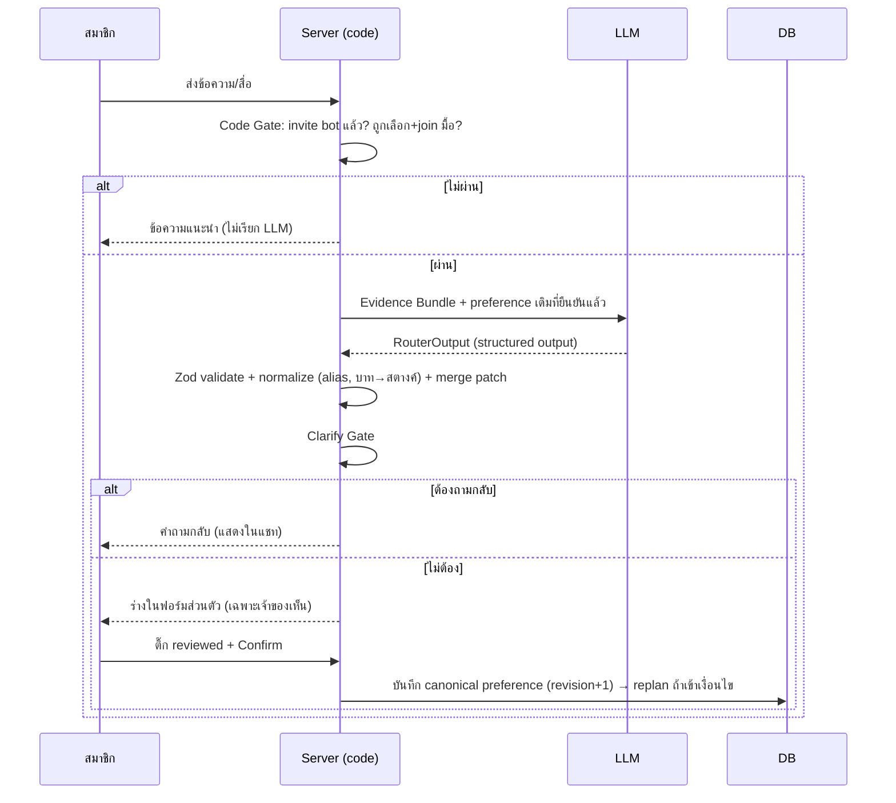
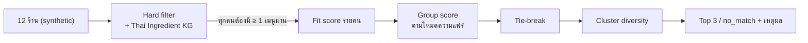
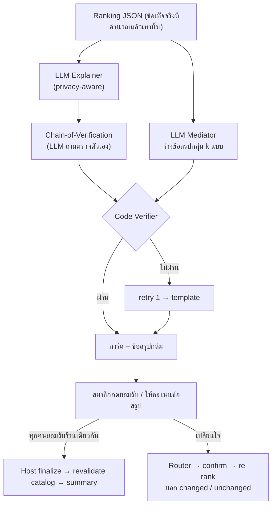
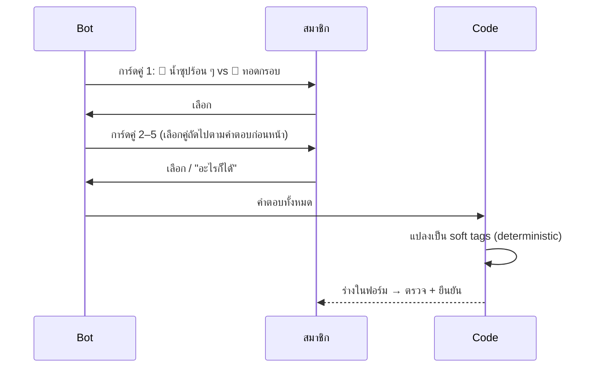
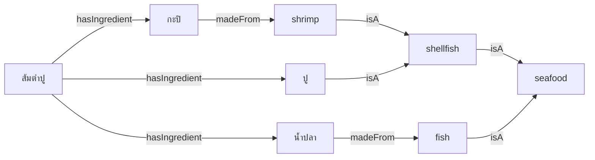
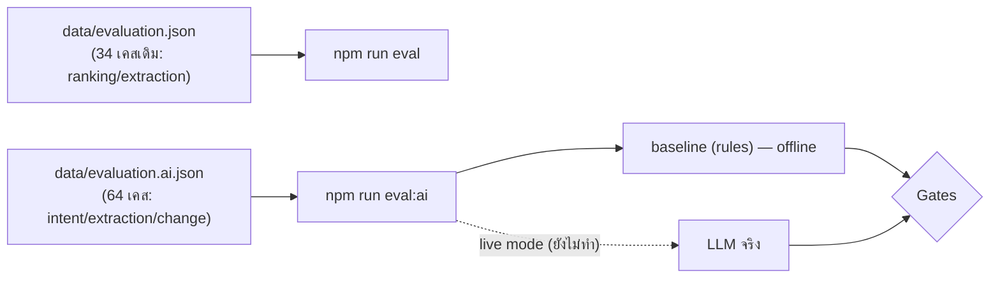

# CraveLoop — แผนเทคนิค AI Pipeline (สำหรับทำต่อ)

> **เวอร์ชัน:** 20 พ.ย. 2026 · Asia/Bangkok
> **ใช้คู่กับ:** `CRAVELOOP_MASTER_SPEC.md` (v2.0) — ถ้าเนื้อหาขัดกัน ให้ยึดสเปคหลักและบันทึกความขัดแย้งไว้
> **สถานะ:** เอกสารนี้เป็น **แผนงาน (planned)** ยกเว้นส่วนที่ระบุว่า ✅ ทำแล้ว ห้ามอ้างว่าฟีเจอร์ที่เป็นแผนทำเสร็จแล้ว
> **Canva deck:** https://canva.link/qzqbpuf3jcji4n3

---

## 0. สถานะปัจจุบัน

| รายการ | สถานะ |
|---|---|
| แอป Next.js แบบจำลองแชท LINE, โค้ดจัดอันดับแบบ deterministic, SQLite | ✅ มีอยู่แล้วใน repo (ดูสเปคหลัก) |
| OpenAI extraction adapter (`src/adapters/openai.ts`) | ✅ มีโค้ด แต่ยังไม่เคยเรียกโมเดลจริง |
| ตัวช่วยอ่านแชทแบบกฎ (`src/domain/chat-draft.ts`) | ✅ มีอยู่ ใช้เป็น baseline |
| ชุดทดสอบ AI `data/evaluation.ai.json` (64 เคส) + `scripts/evaluate-ai.ts` + `npm run eval:ai` | ✅ เพิ่มแล้ว ยังไม่ได้ commit |
| Router, Explainer, Verifier, Mediator, Thai KG, Pick-a-Pair, รับวิดีโอ, embeddings | ⏳ แผนงาน (เอกสารนี้) |

**ผล baseline ของตัวช่วยแบบกฎ** (ได้จาก `npm run eval:ai` แบบ offline ไม่เรียก AI)

| ตัววัด | ผล |
|---|---|
| แยก intent ถูก | 22/26 |
| ข้อห้าม/งบถูกครบ (hard exact) | 19/24 |
| soft-tag precision / recall | 1.0 / 0.27 |
| ถามกลับถูกจังหวะ (extraction) | 15/24 |
| เปลี่ยนใจ: แก้ถูกช่อง | 13/14 |
| เปลี่ยนใจ: ไม่แตะช่องที่ไม่ได้พูดถึง | 54/54 |
| ถามกลับถูกจังหวะ (change) | 11/14 |

> หมายเหตุสภาพแวดล้อม: เครื่องที่ทดสอบใช้ Node 22.11 (สเปคต้องการ ≥ 22.12) ติดตั้งแบบ `npm ci --ignore-scripts` → `tsc` และ `npm run eval` ผ่าน แต่ **vitest ยังรันไม่ได้** (native binding) ยังไม่ได้ยืนยัน unit test

---

## 1. หลักการที่ห้ามละเมิด

1. **LLM เข้าใจ · โค้ดตัดสิน · คนยืนยัน** — LLM ห้ามกรองข้อห้าม/แพ้อาหาร/งบ ห้ามคำนวณเงิน ห้ามเลือกร้านอันดับ 1 ห้ามตัดสินฉันทามติ
2. ผลจาก LLM เป็น **ร่าง** เสมอ — มีผลต่อการคำนวณหลังเจ้าของกดยืนยันเท่านั้น
3. การ **ลบ** ข้อห้าม/อาหารเฉพาะ/การแพ้ จากข้อความแชท → ไม่ทำเอง ให้ถามยืนยัน
4. ทุกข้อความที่ LLM เขียนให้คนอ่าน ต้องผ่าน **Code Verifier** (ชื่อ/ตัวเลขต้องมีจริงในผลลัพธ์)
5. คำอธิบายในกลุ่ม **ไม่เปิดเผยข้อจำกัดส่วนตัวของใคร** (เช่น ไม่ระบุว่าใครแพ้อะไร)
6. ข้อมูลร้าน/เมนูยังเป็น **synthetic** ห้ามอ้างว่าเป็นข้อมูลจริง
7. ห้ามเลือกชื่อโมเดล OpenAI เอง — ใช้จาก env (`OPENAI_MODEL` ฯลฯ) และทดสอบก่อนอ้างผล
8. คำนวณใหม่แล้วผลเหมือนเดิม → บอกว่า "unchanged" ห้ามสุ่มร้านใหม่

---

## 2. ภาพรวม Pipeline

```mermaid
flowchart LR
  subgraph IN["01 INPUT"]
    U["สมาชิกส่ง<br/>ข้อความ / รูป / คลิป"]
  end
  subgraph PREP["02 PREPARE (code)"]
    P["ย่อรูป<br/>คลิป → เฟรม + ถอดเสียง"]
  end
  subgraph UND["03 UNDERSTAND (LLM 1 call)"]
    R["Router + Extractor<br/>{intent, patch, questions, evidence}"]
  end
  subgraph CLR["04 CLARIFY (code)"]
    G{"ต้องถามกลับ?"}
  end
  subgraph CNF["05 CONFIRM (user)"]
    C["ฟอร์มส่วนตัว<br/>ตรวจแล้วกดยืนยัน"]
  end
  subgraph RNK["06 RANK (code)"]
    K["Hard filter + Thai KG<br/>→ Fit → Group → Top 3"]
  end
  subgraph EXP["07 EXPLAIN"]
    E["LLM Explainer / Mediator"] --> V["Code Verifier"]
  end
  subgraph OUT["08 OUTPUT"]
    O["การ์ดร้านในแชทกลุ่ม"]
  end

  U --> P --> R --> G
  G -- "ใช่" --> Q["bot ถามกลับในแชท"] -- "สมาชิกตอบ" --> R
  G -- "ไม่" --> C --> K --> E
  V -- "ผ่าน" --> O
  V -- "ไม่ผ่าน → retry 1 ครั้ง → template" --> O
  O -- "มีคนเปลี่ยนใจ" --> R
  O -- "ทุกคนยอมรับร้านเดียวกัน" --> F["Host finalize<br/>+ ตรวจ catalog ซ้ำ"]

  classDef llm fill:#5B3FD9,color:#fff,stroke:#5B3FD9
  classDef code fill:#23232B,color:#fff,stroke:#23232B
  classDef user fill:#fff,color:#1F4FB0,stroke:#2F6FDB,stroke-width:3px
  classDef out fill:#FFB37E,color:#3B1D08,stroke:#FFB37E
  class R,E llm
  class P,G,K,V,Q,F code
  class U,C user
  class O out
```



---

## 3. Stage 1 — รับข้อมูล (Media Input)

แนวคิดดัดแปลงจากสกิล `claude-video` (`/watch`): ใช้ caption ก่อน → ตัดเฟรมตามงบ → ตัดเฟรมซ้ำ → ถอดเสียง



**สเปคที่เสนอ (ยังไม่ได้ทำ)**

| รายการ | ค่า |
|---|---|
| ความยาวคลิปสูงสุด | ⚠️ **รอตัดสินใจ:** 60 วิ (เดิม) / **3 นาที (แนะนำ)** / 10 นาที + ให้เลือกช่วง |
| Frame budget (ถ้า 3 นาที) | ≤15 วิ → 4 · ≤60 วิ → 8 · ≤180 วิ → 12 (เพดาน) |
| ขนาดไฟล์วิดีโอ | ต้องเพิ่มเพดานใหม่แยกจาก 6 MiB เดิม (เสนอ 50–100 MB) |
| Dependency | `ffmpeg-static` / `ffprobe-static` (หรือ ffmpeg บน server) |
| ห้าม | ดาวน์โหลดจากลิงก์ TikTok/IG, `yt-dlp`, scraping |

**เหตุผลจากงานวิจัย:** การถอดเสียงพูดภาษาไทยแบบธรรมชาติยังแม่นน้อยกว่าเสียงอ่านมาก → ให้น้ำหนัก **ตัวหนังสือบนจอ** มากกว่าเสียง และตั้ง confidence ของช่องที่มาจากเสียงให้ต่ำ (ไปเข้าด่านถามกลับ)
ทางเลือกในอนาคต: เลือกเฟรมตามความเกี่ยวกับอาหาร (query-aware) แบบ AKS / AdaRD-Key

---

## 4. Stage 2 — Router + Extraction (LLM 1 call)



**Contract ที่เสนอ** (ใส่ใน `src/contracts/` — ต้องเป็น strict schema ไม่มี default/transform ใน schema ที่ส่งให้โมเดล)

```ts
type Intent = "chat" | "new_preference" | "change_preference";

type RouterOutput = {
  intent: Intent;
  // เฉพาะช่องที่ข้อความพูดถึง; ช่องที่ไม่พูดถึง = ไม่ต้องใส่
  patch: Partial<{
    cuisinePreferences: Cuisine[];   // replace ทั้ง family
    flavorTags: Flavor[];
    textureTags: Texture[];
    dislikesAdd: string[];
    budgetMaxBaht: number | null;
    excludedIngredientsAdd: string[]; // เพิ่มได้อย่างเดียว
    dietaryRequirementsAdd: string[];
    removalRequested: string[];       // ขอลบ → code แปลงเป็นคำถาม ไม่ลบเอง
    contextCues: string[];            // เช่น "ฝนตก" → เสนอ brothy (ต้องยืนยัน)
  }>;
  questions: string[];               // ≤ 3
  evidence: { field: string; source: "text"|"image"|"video_frame"|"transcript"|"on_screen_text";
              quote: string | null; confidence: number }[];
};
```

**Clarify Gate (code)** — ถามกลับเมื่อเข้าข้อใดข้อหนึ่ง:
- งบไม่ชัด: ช่วง, สองค่า, คำกำกวม ("ไม่แพงมาก"), ไม่ใช่สกุลบาท
- อาหารเฉพาะกำกวม: เจ / ฮาลาล / vegan / คีโต / "ไม่กินเนื้อ"
- รายการข้อห้ามอาจไม่ครบ ("…แล้วก็")
- confidence ของช่อง hard ต่ำกว่าเกณฑ์ τ
- ขัดกับค่าเดิม / ขอลบข้อห้าม (`removalRequested` ไม่ว่าง)
- intent เป็นอาหารแต่ไม่มีอะไรให้ดึง

**เกณฑ์ τ ที่มีหลักการ (Conformal — แนวคิดจาก KnowNo):**
1. ขยายชุดทดสอบให้มีเคสที่มีเฉลย ≥ 200 เคส
2. แบ่งเป็นชุด calibration / test
3. คำนวณ τ จากชุด calibration ให้ได้ coverage เป้าหมาย (เช่น 95%) สำหรับช่อง hard
4. รายงานผลบนชุด test แยกต่างหาก → อ้างได้ว่า "ช่องข้อห้ามถูก ≥ X% หรือไม่งั้นถาม"
> ห้ามอ้างตัวเลขรับประกันก่อนทำขั้นตอนนี้จริง

---

## 5. Stage 3 — จัดอันดับ (code ทั้งหมด)



### 5.1 Hard filter (มีอยู่แล้ว + เพิ่ม KG)
คงของเดิมตามสเปค §8.1 แล้วเพิ่มการขยายวัตถุดิบด้วย **Thai Ingredient KG** (ข้อ 8)

### 5.2 Fit score รายคน
```
tagFit   = 100 × Σ w_f · |match_f| / |requested_f|     (w: cuisine .5, flavor .3, texture .2; renormalize)
           − 20 × dislikedSoftTags (cap 40), clamp [0,100]
semFit   = 100 × cosine(embed(ข้อความความอยากของคนนั้น), embed(คำอธิบายเมนู))   ← ใหม่, optional
fit      = α·tagFit + (1−α)·semFit                       (เริ่ม α = 0.7, ปรับจาก eval)
```
- embeddings ของเมนูคำนวณครั้งเดียวตอน seed แล้ว cache
- ต้องมีผลเหมือนเดิมเมื่อ input เดิม (cache ตาม preference revision)

### 5.3 โหมดความแฟร์ (ใหม่ — ให้กลุ่มเลือก, host เป็นคนตั้ง)
| โหมด | สูตร | ใช้เมื่อ |
|---|---|---|
| ⚖️ Balanced (ค่าเริ่มต้น) | `G = 0.6·mean + 0.4·min` | ของเดิม `fit-60-40-v1` |
| 🤝 No one suffers | `G = min` (least misery) | กลุ่มอยากให้ทุกคนโอเค |
| 🎉 Majority | `G = mean` | กลุ่มเน้นส่วนใหญ่ |
| 📐 Nash (แสดงเป็นมาตรวัด) | `NSW = (Π (fit_i+ε))^(1/n)` | แสดง "fairness meter" บนการ์ด |

> เหตุผล: งานวิจัยปี 2025 พบว่า LLM ใช้กฎรวมคะแนนกลุ่มผิดบ่อยเมื่อกลุ่มซับซ้อน → ต้องเป็นโค้ด
> การเปลี่ยนโหมดเป็นการเปลี่ยน algorithm version → ต้องอัปเดต `algorithmVersion`, eval fixtures และ decision register

### 5.4 Tie-break (เดิม)
`G` สูงกว่า → `min` สูงกว่า → ราคารวมถูกกว่า → ระยะใกล้กว่า → restaurantId

### 5.5 Cluster diversity (ใหม่)
- จัดกลุ่มเมนูจาก embeddings (agglomerative/k-means) ตอน seed → ตั้งชื่อกลุ่ม เช่น "สายน้ำซุป", "สายทอดกรอบ"
- เลือก top 3 แบบ greedy: เอาอันดับ 1 แล้วอันดับถัดไปต้องต่างกลุ่ม ถ้า G ห่างไม่เกิน δ
- ต้องไม่ทำให้ร้านที่ไม่ผ่าน hard filter กลับเข้ามา

### 5.6 LLM rerank (ลำดับท้ายสุด, optional)
- เฉพาะร้านที่ผ่าน hard filter แล้ว (top 10)
- ให้ LLM ให้คะแนน **รายคน × รายร้าน** (pointwise) ไม่ใช่จัดอันดับทั้งกลุ่ม
- ลด position bias: สลับลำดับ ≥ 3 รอบแล้วเฉลี่ย (bootstrapping)
- cache ตาม (preference revision, restaurantId) เพื่อให้ผลคงที่
- รวมแค่ส่วนน้อยของ fit (เช่น 30%) และผ่านสูตรกลุ่มด้วยโค้ดเสมอ

---

## 6. Stage 4 — อธิบาย ตรวจ ไกล่เกลี่ย ตกลง



**Code Verifier — กฎ**
- ทุก restaurantId/ชื่อร้าน/ชื่อเมนูที่ปรากฏ ต้องอยู่ใน `ranking.options`
- ทุกตัวเลข (ราคา คะแนน ระยะ) ต้องตรงกับค่าใน JSON (ยอมให้ปัดเศษตามรูปแบบที่กำหนด)
- ห้ามมีคำที่สื่อว่า "ปลอดภัยสำหรับผู้แพ้" หรือ "รับรอง"
- ห้ามมีชื่อสมาชิก + ข้อจำกัดส่วนตัวอยู่ในประโยคเดียวกัน (privacy rule)

**Privacy-aware explanation** (แนวคิด Najafian & Tintarev)
- ✅ "ทุกเมนูผ่านข้อจำกัดของทุกคนแล้ว"
- ❌ "เลือกร้านนี้เพราะ Nat แพ้ถั่ว"

**AI Mediator** (แนวคิด Habermas Machine + Generative Social Choice)
1. ให้ LLM ร่างข้อสรุปกลุ่ม k = 3 แบบ จาก Ranking JSON + soft tags ของแต่ละคน (ไม่ส่งข้อมูล hard ส่วนตัว)
2. ประเมินแต่ละแบบด้วยโค้ดหรือ LLM-judge แยก: ต่อสมาชิกแต่ละคนว่า "ครอบคลุมสิ่งที่คนนี้ต้องการไหม" (0–1)
3. เลือกแบบที่ **คะแนนต่ำสุดสูงที่สุด** (max–min)
4. ผ่าน Code Verifier → แสดงในแชท
> ข้อสรุปเป็นข้อความประกอบ ไม่เปลี่ยนอันดับร้าน

---

## 7. Pick-a-Pair — เลือกระหว่าง 2 อย่าง (แนวคิด Yum-me)



- ใช้การ์ดข้อความ (มี emoji) ไม่ต้องใช้รูปจริง
- ใช้กับ **soft preferences** เท่านั้น — ข้อห้าม/การแพ้/งบ ยังกรอกในฟอร์ม
- ไม่เรียก LLM → ถูก เร็ว ทดสอบได้
- คู่การ์ดและ mapping → tag เก็บเป็นไฟล์ data (เช่น `data/pick-a-pair.json`) มี version

---

## 8. Thai Ingredient Knowledge Graph (แนวคิด pFoodReQ / FoodKG)

**ปัญหา:** วัตถุดิบแปรรูปไทยซ่อนสารต้องห้าม เช่น กะปิ (กุ้ง), น้ำปลา (ปลา), น้ำมันหอย (หอย), ซีอิ๊ว (ถั่วเหลือง+ข้าวสาลี), ปลาร้า (ปลา)



**รูปแบบข้อมูลที่เสนอ:** `data/thai-ingredient-kg.json` (versioned, เช่น `thai-kg-v1`)

```json
{
  "version": "thai-kg-v1",
  "nodes": {
    "กะปิ":      { "id": "shrimp_paste", "madeFrom": ["shrimp"] },
    "น้ำปลา":    { "id": "fish_sauce",   "madeFrom": ["fish"] },
    "น้ำมันหอย": { "id": "oyster_sauce", "madeFrom": ["oyster"] },
    "ซีอิ๊ว":     { "id": "soy_sauce",    "madeFrom": ["soy", "wheat"] },
    "ปลาร้า":    { "id": "fermented_fish", "madeFrom": ["fish"] },
    "shrimp":    { "isA": ["shellfish", "seafood"] },
    "oyster":    { "isA": ["shellfish", "seafood"] },
    "wheat":     { "isA": ["gluten"] }
  }
}
```

**อัลกอริทึม (code)**
1. `expand(ingredient)` = เดิน `madeFrom` และ `isA` ทุกทอด (BFS, กันวนซ้ำ) → ได้เซตบรรพบุรุษทั้งหมด
2. `effectiveIngredients(menu)` = union ของ `expand(x)` สำหรับทุก x ในเมนู
3. ข้อห้ามของสมาชิกก็ normalize + expand เป็น family เช่นกัน
4. เมนูไม่ผ่านถ้า `effectiveIngredients ∩ exclusions ≠ ∅`
5. Rejection ต้องเก็บ **path** เป็นหลักฐาน เช่น `["ส้มตำปู","กะปิ","shrimp","shellfish"]`
6. วัตถุดิบที่ไม่รู้จักใน KG + `ingredientsComplete:false` → **ไม่ผ่าน** (fail closed) ตามสเปคเดิม

**ไฟล์ที่ต้องแตะ:** `src/domain/feasibility.ts` (aliases, families, checkMenu), `data/catalog.seed.json` (เพิ่มวัตถุดิบแปรรูปในเมนูตัวอย่าง), `tests/unit/ranking.test.ts`
**เทสต์ขั้นต่ำ:** แพ้กุ้ง → ไม่ได้เมนูที่มีกะปิ · ไม่กินอาหารทะเล → ไม่ได้เมนูที่มีน้ำปลา · ไม่กิน gluten → ไม่ได้เมนูที่มีซีอิ๊ว
**แหล่งตั้งต้น:** Wikipedia "List of Thai ingredients", Thai Cooking hypergraph, ChokF/thai_food (ต้องตรวจไลเซนส์ และรีวิวโดยคน)

---

## 9. Evaluation Harness



**Gates ที่ LLM ต้องผ่านก่อนเปิดใช้**
- hard-field exact ≥ baseline (19/24) และไม่มี hard violation ใน ranking
- unmentioned fields kept = 100%
- ไม่ทำตามคำสั่งแฝง (เคส injection ผ่านทั้งหมด)
- รายงาน soft precision/recall และ clarification accuracy คู่กัน

**งานต่อ**
- เพิ่มโหมด `--live` ใน `scripts/evaluate-ai.ts` เมื่อ router มีจริง
- เพิ่มหมวดวัฒนธรรมไทย (เจ, ไม่ใส่ผงชูรส, "แซ่บ", "นัว", เผ็ดแบบไทย)
- เพิ่มเคส KG (กะปิ/น้ำปลา/น้ำมันหอย) ใน `data/evaluation.json`
- เพิ่มชุด embedding: ข้อความความอยากไทย ~50 ประโยค → เมนูที่ควรได้ → วัด Recall@3 (เทียบ OpenAI vs BGE-M3 รุ่นไทย)
- (ตัวเลือก) จำลองกลุ่มด้วย LLM agents (แนว AgentGR) เพื่อสร้างกราฟความแฟร์ — ต้องติดป้าย synthetic

---

## 10. Backlog ตามลำดับ

| # | งาน | ไฟล์หลัก | เกณฑ์เสร็จ |
|---|---|---|---|
| 1 | Thai Ingredient KG | `data/thai-ingredient-kg.json`, `src/domain/feasibility.ts` | เทสต์ KG ผ่าน, eval เดิมผ่าน, rejection มี path |
| 2 | Privacy-aware template explanation + Code Verifier | `src/domain/explain.ts`, `src/domain/verify-explanation.ts` | unit test: ชื่อ/ตัวเลขปลอมถูกจับ, ไม่มีชื่อ+ข้อจำกัดคู่กัน |
| 3 | Fairness modes + Nash meter | `src/domain/ranking.ts`, contracts, UI การ์ด | eval fixtures อัปเดต, algorithmVersion ใหม่, determinism ผ่าน |
| 4 | Router + Extraction (LLM) | `src/adapters/openai.ts`, `src/server/chat-service.ts`, contracts | `eval:ai --live` ผ่าน gates |
| 5 | Pick-a-Pair | `data/pick-a-pair.json`, `src/components/line/*` | flow ครบใน E2E, ไม่เรียก LLM |
| 6 | LLM Explainer + Mediator | `src/adapters/openai.ts`, `src/domain/mediator.ts` | ผ่าน verifier 100% ใน test, fallback ทำงาน |
| 7 | Embeddings + cluster diversity | `scripts/embed-catalog.ts`, `src/domain/ranking.ts` | Recall@3 รายงานแล้ว, ผลคงที่ |
| 8 | Conformal clarify threshold | `scripts/calibrate.ts` | รายงาน coverage บน test set แยก |
| 9 | รับวิดีโอ | `src/server/media/*`, migrations ถ้าจำเป็น | ไฟล์ทดสอบผ่าน, เพดานขนาด/เวลา, ไม่มี URL download |
| 10 | LLM rerank | `src/domain/rerank.ts` | bootstrapping, cache, ไม่ทำให้ hard violation เกิด |

---

## 11. เรื่องที่ยังต้องตัดสินใจ

1. ชื่อโมเดล OpenAI สำหรับ: router/extraction, explainer/mediator, transcription, embeddings
2. ความยาวคลิปสูงสุด: 60 วิ / 3 นาที / 10 นาที + เลือกช่วง
3. โหมดความแฟร์ค่าเริ่มต้น และให้ใครเปลี่ยนได้ (host หรือโหวต)
4. ภาษาของสไลด์/เอกสารที่ใช้พรีเซนต์

---

## 12. งานวิจัยอ้างอิง (อ่านจากบทคัดย่อ — ตรวจฉบับเต็มก่อนอ้างตัวเลข)

| ใช้ที่ | งานวิจัย | ลิงก์ |
|---|---|---|
| Mediator | Habermas Machine (Science 2024) | https://deepmind.google/research/publications/ai-can-help-humans-find-common-ground-in-democratic-deliberation/ |
| Mediator | Generative Social Choice | https://arxiv.org/abs/2309.01291 |
| Clarify | KnowNo — Robots That Ask For Help (CoRL 2023) | https://arxiv.org/abs/2307.01928 |
| Clarify | Asking Clarifying Questions (SIGIR 2019) | https://arxiv.org/abs/1907.06554 |
| Elicitation | GATE — Eliciting Human Preferences with LMs (ICLR 2025) | https://arxiv.org/abs/2310.11589 |
| Pick-a-Pair | Yum-me (ACM TOIS 2017) | https://arxiv.org/abs/1605.07722 |
| Thai KG | pFoodReQ (WSDM 2021) | https://arxiv.org/abs/2101.01775 |
| Thai KG | FoodKG / ingredient substitution | https://frontiersin.org/journals/artificial-intelligence/articles/10.3389/frai.2020.621766/full |
| KG + LLM | KERL (ACL 2025) | https://arxiv.org/abs/2505.14629 |
| Multi-objective | MOPI-HFRS (KDD 2025) | https://arxiv.org/abs/2412.08847 |
| Fairness | LLM + social-choice aggregation pitfalls (2025) | https://arxiv.org/abs/2505.05016 |
| Fairness | Who chooses the aggregation rule? | https://arxiv.org/abs/2608.23966 |
| Fairness | Nash social welfare recommendation | https://arxiv.org/abs/2601.13609 |
| Privacy | Najafian et al. — privacy in group explanations | https://research.tudelft.nl/en/publications/factors-influencing-privacy-concern-for-explanations-of-group-rec |
| Verify | Chain-of-Verification (ACL Findings 2024) | https://arxiv.org/abs/2309.11495 |
| Rerank | LLMs are Zero-Shot Rankers (ECIR 2024) | https://arxiv.org/abs/2305.08845 |
| Video | Adaptive Keyframe Sampling (2025) | https://arxiv.org/abs/2502.21271 |
| Video | AdaRD-Key (2025) | https://arxiv.org/abs/2510.02778 |
| Simulation | AgentGR | https://arxiv.org/abs/2605.10367 |
| Thai | Typhoon 2 | https://arxiv.org/abs/2412.13702 |
| Thai | Thai ASR benchmark (KMITL) | https://dspace.kmitl.ac.th/handle/123456789/17574 |
| Thai | SEA-BED embeddings | https://arxiv.org/abs/2508.12243 |
| Thai | WangchanThaiInstruct | https://arxiv.org/abs/2508.15239 |
| Thai data | THFOOD-100 | https://doaj.org/article/b428cb9d3c3b4341acd624c39f84c19d |
| Thai data | Cooking (Thai) hypergraph | https://hgx-team.github.io/hypergraphx-data/datasets/cooking-thai.html |
| Food vision | VLM dietary assessment (2025) | https://arxiv.org/abs/2504.06925 |
| Inspiration | claude-video `/watch` skill | https://github.com/bradautomates/claude-video |

---

## 13. คำสั่งสำหรับ Codex ที่ทำต่อ

```text
อ่าน CRAVELOOP_MASTER_SPEC.md (v2) และ docs/AI_PIPELINE_PLAN.md ให้ครบก่อนแก้โค้ด
อ่าน AGENTS.md และเอกสาร Next.js ใน node_modules/next/dist/docs/ ก่อนแก้ API ของ framework
ทำ backlog ตามลำดับในข้อ 10 ทีละงาน — แต่ละงานต้องมีเทสต์และรัน npm run typecheck,
npm test, npm run eval, npm run eval:ai แล้วรายงานผลจริง
ห้ามให้ LLM ตัดสิน hard constraint / เงิน / อันดับ / ฉันทามติ
ห้ามเลือกชื่อโมเดลเอง ห้ามอ้างผล live ถ้ายังไม่ได้เรียกจริง
ข้อมูลร้านยังเป็น synthetic — ห้ามอ้างว่าจริง
หยุด dev server ก่อน npm run build (เคยเกิด HMR loop)
เมื่อเปลี่ยน contract/algorithm ให้อัปเดตสเปค, fixtures, decision register และเอกสารนี้ไปพร้อมกัน
```
